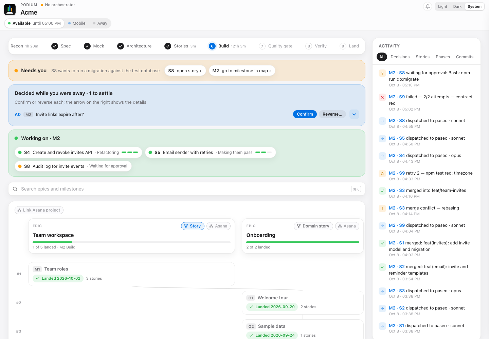
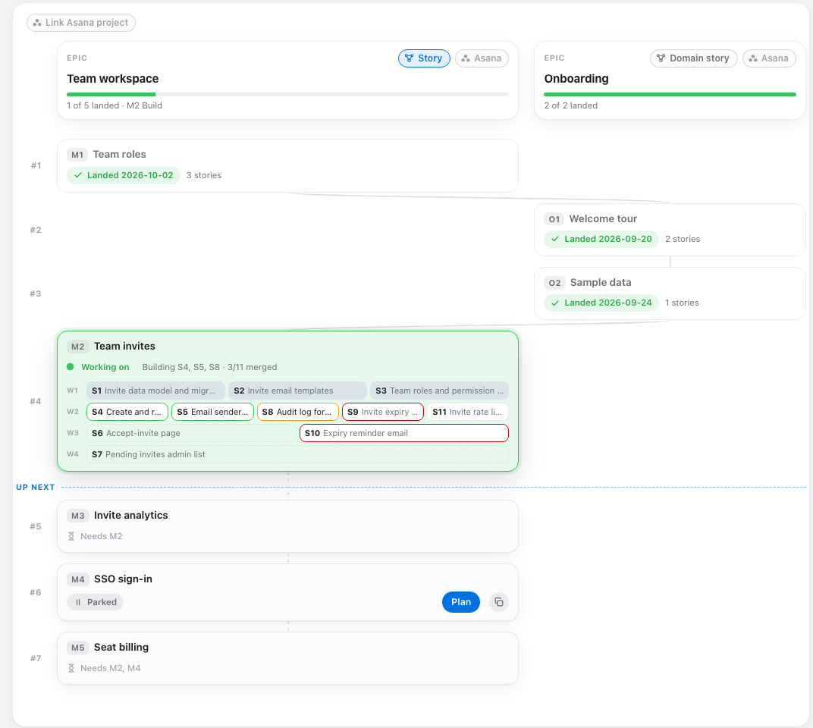

# /orchestrate-deep-plans

Plans a feature or product as epics and milestones with `/deep-plan`, breaks each milestone into stories, and builds them in parallel, one agent per story, driven from the Podium (a live dashboard on localhost). Use it for a feature with several independent stories, or to pick up a half-done `/deep-plan` project.

## The Podium

The Podium on the sample run of [podium-dashboard](https://github.com/warriv93/podium-dashboard), the tool that serves it. At the top: the pipeline stepper, what needs you (here a story waiting for approval), a decision taken while you were away, and the stories being built right now. The activity feed runs down the right.



Further down, the map. Each epic is a column, milestones run in landing order, and the active milestone shows its stories by wave, coloured by status. Up next are the milestones still to plan, with a Plan button.



## What it does

- A bare `/orchestrate-deep-plans` only maps: it syncs, starts the Podium and its watcher, and reports what is active, done, draft, parked and waiting on you. Work starts when you name it or press a Podium button.
- Cuts each new epic into milestones a user can notice, using Humanizing Work's splitting patterns, warns about milestones with no user-visible change, settles questions that touch several milestones with you first as epic decisions, and gets one sign-off on the cut before planning any of them.
- Plans the active milestone through `/deep-plan` up to its spec and tasks, in fresh background subagents so each phase starts with a clean context. It can plan later milestones ahead in their own worktrees while one builds.
- Turns each user-story slice of `tasks.md` into a story with a brief, dependencies, files and a model (Opus for money, dates, concurrency, auth, migrations and core algorithms, Sonnet for the rest). Stories sharing a file land in different waves.
- The Podium (`podium server`, port 8765 or the next free one) shows the epic, milestone and story maps with live status and an activity feed. Its buttons plan a milestone, assign a story, build all of a milestone's stories, hand a story to a session of your own, draw an epic or a milestone as domain stories (a milestone's shows only what it changes, starting from the epic's drawing when there is one), and set you Available, Mobile or Away. It runs detached and stops itself after an hour nobody uses it.
- Each story agent works test-first in its own worktree on `story/<id>`, commits locally and never pushes. The orchestrator merges each story into the milestone branch, runs the contract, and undoes the merge on a conflict or a red contract. A failed story gets one retry, then waits for you.
- Builds a second milestone beside the first, in its planning worktree, when the two change different files, or when you accept the conflicts its merge may bring. Each has its own Build all, and its stories an id prefix of their own.
- Hands the milestone back to `/deep-plan` for its quality gate, verification, debrief and local merge.
- Once a milestone lands with friction (a retried or failed story, a merge conflict, a quality gate short of pass, a permission prompt a story stopped on), a retro subagent records findings in your findings remote (`"findings"` in `~/.podium/improve.json`; without one findings stay local), and each turn lists the ones that keep recurring across runs.
- Tracks whether you're available, mobile or unavailable, from your hours or the Podium toggle. On mobile it asks only what blocks the run and shows screenshots in chat. While you're unavailable it takes the option it would recommend for each question, records it as an assumption you later confirm or reverse, merges milestones that pass verify locally, and denies Paseo agents' permission prompts.
- With an Asana project or task linked, its tasks are epics and their subtasks milestones. It re-reads them at every sync.
- Adopts a repo whose `.deep-plan/` holds earlier `/deep-plan` runs, grouping them into epics with their commits.
- Lets two people share one run from two machines: each claims the milestones they plan and build, the other's progress shows up in the Podium and the chat, and neither can launch, merge or land a milestone the other owns.

What leaves the machine on its own: the run state, synced through git to `refs/heads/podium-run/<repo>` on origin after each major event (a run from before keeps its `podium` branch), merged with what another machine or person saved, never overwriting it, so the run can carry on from another machine; findings from a milestone's retro, pushed to `refs/heads/findings/<run>` on your findings remote (`"findings"` in `~/.podium/improve.json`); and, with Asana linked, completing a milestone's subtask when it lands. Pushing code, opening or readying a PR and deleting always wait for you.

## Use

```
/orchestrate-deep-plans <feature description, a milestone id, an Asana project or task link, or nothing to adopt>
```

`/orchestrate-deep-plans M2` plans or resumes milestone M2. The run state lives in `.deep-plan/podium/`, beside `/deep-plan`'s files, and an epic's or milestone's domain stories in `.deep-plan/domain-stories/<id>/`. `podium` with no arguments lists its commands.

## Install

```sh
./install.sh
```

Run it from the repo root; it symlinks every skill into `~/.claude/skills/`. Then install the `podium` command from [podium-dashboard](https://github.com/warriv93/podium-dashboard); the skill, `/deep-plan` and the story agents run every Podium command through it, and it loads this skill's `podium_ext.py` for the orchestration verbs:

```sh
pip3 install --user git+https://github.com/warriv93/podium-dashboard
```

To edit the tool live, install a clone instead: `pip3 install --user -e <clone>`. A second machine or person joins a run with `podium --dir <repo>/.deep-plan sync on --ref <ref>` (the ref `podium sync status` prints where the run started), then `podium sync pull`, and `podium whoami <name>` names you when your git email's local part shouldn't.

Also needs:

- `/deep-plan` with everything it needs (see [its README](../deep-plan/README.md)).
- Optional: the `deep-domain-storytelling` skill, installed separately, for the Domain story button.
- `python3`, `git` and `curl`, write access to `origin` for sync, and, for findings to leave the machine, a private git remote of your own named in `~/.podium/improve.json` as `"findings"` (without one, findings stay local).
- Optional: Paseo, whose CLI dispatches story agents into Paseo workspaces and whose MCP tools open the Podium in Paseo's browser (pass the `paseo` binary to `podium watch --paseo`). Without Paseo, stories run as background `Agent` subagents. For Asana links, the Asana MCP tools, or a personal access token in the keychain so `podium` reads Asana itself (`asana.md`, Refresh). Playwright for the screenshots it sends while you're mobile.
- Outside Claude Code (Antigravity, Gemini): the `claude-tool-map` skill, which `install.sh` links when `~/.gemini/config/` exists.

## Defaults to know

- Hours default to Mon-Fri 07:00-17:00, local time; `podium hours Mon-Thu 08:00-16:00` changes them. Outside them it treats you as unavailable and keeps building on its own. Hours and the Available/Mobile/Away toggle are one per machine, in `~/.podium/human.json`, shared by every Podium, `/orchestrate-plan`'s included.
- Completing an Asana subtask when its milestone lands is an approval written into the skill (`asana.md` calls it "the user's standing approval"). Remove it if you don't give that approval.
